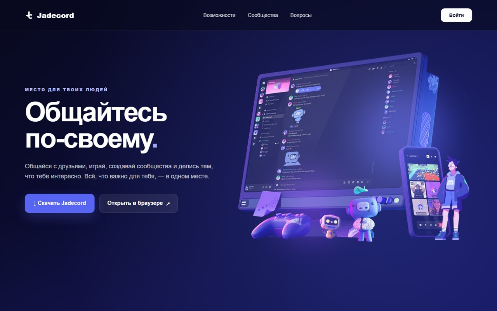
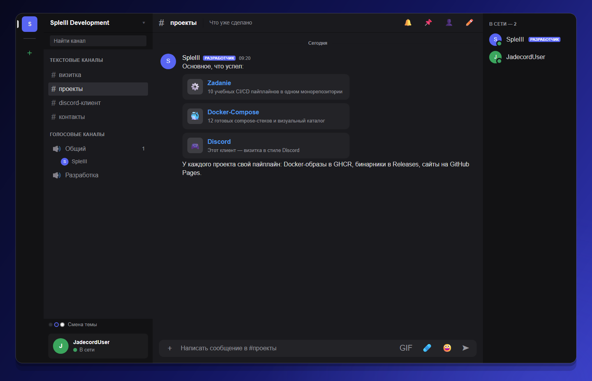
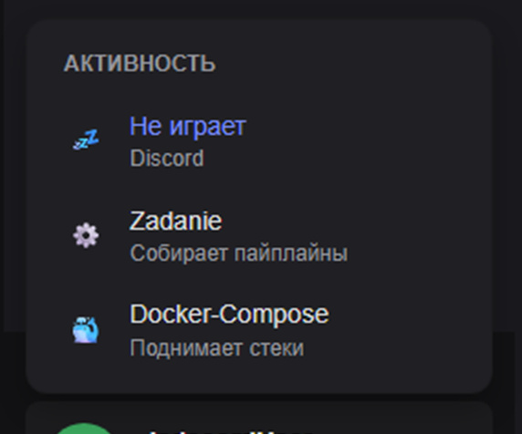
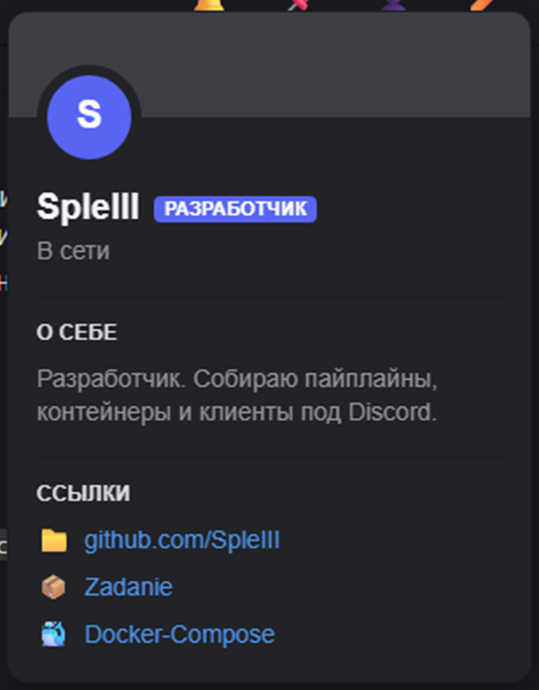
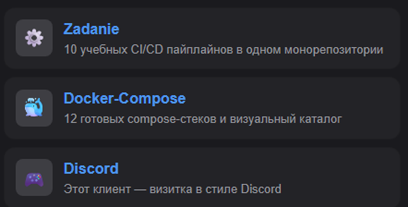
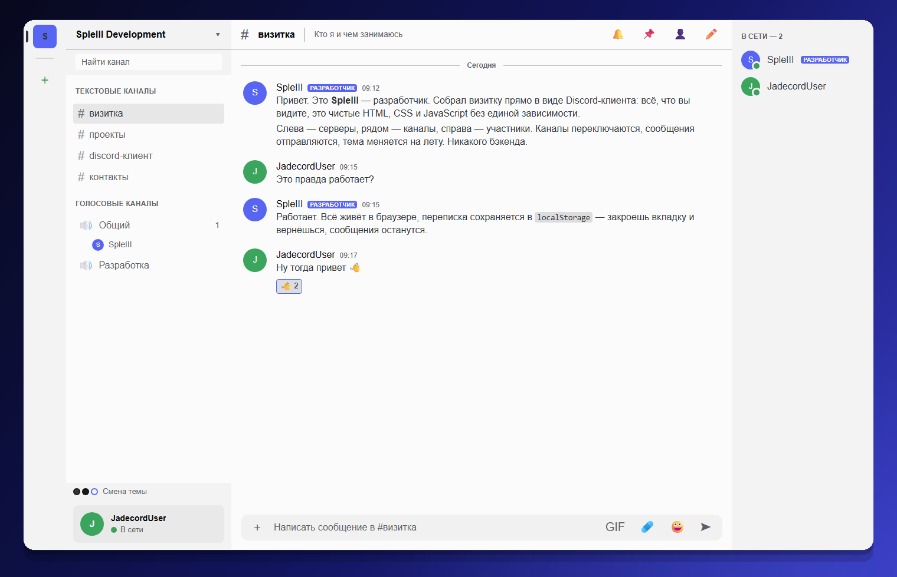

<p align="center">
  
</p>

<h1 align="center">Jadecord</h1>

<p align="center">
  <b>Главная страница и рабочий веб-клиент мессенджера в стиле Discord.</b><br>
  Серверы, каналы, переписка, участники и Rich Presence — на чистых HTML, CSS и JavaScript.<br>
  Без фреймворков, сборщиков и единой сторонней зависимости.
</p>

<p align="center">
  
  
  
  
</p>

<p align="center">
  
  
  
</p>

<p align="center">
  
</p>

---

## 📖 О проекте

**Jadecord** — учебный командный проект, в котором мы собрали две половины одного продукта:

- **Главная страница** — промо-лендинг в стиле Discord: тёмно-синий градиент, крупная типографика,
  объёмная иллюстрация и блоки с возможностями, сообществом и ответами на вопросы.
- **Веб-клиент** — интерактивный интерфейс мессенджера: рельс серверов, каналы, переписка,
  список участников, карточки профилей и панель Rich Presence.

Интерфейс клиента собран не «на глаз». Размеры сетки и палитра сняты из публичных стилей
настоящего `discord.com/app` — поэтому всё выглядит знакомо: рельс серверов **72px**,
сайдбар каналов **280px**, шапка чата **49px**, аватар сервера **40px** и фирменный `#5865F2`.

Бэкенда нет и не требуется: состояние живёт в `localStorage`, а весь контент — в одном
JavaScript-файле `js/data.js`. Достаточно открыть страницу, чтобы всё заработало.

| Часть проекта | Папка | Что это | Живая версия |
|:--|:--|:--|:--|
| 🌐 **Главная страница** | `pages/main/` | лендинг: hero, возможности, сообщества, CTA, FAQ | [открыть](https://arthuraleksandrovitch.github.io/discord-project/) |
| 💻 **Веб-клиент** | `pages/app/` | интерфейс мессенджера с каналами, чатом и Rich Presence | [открыть](https://arthuraleksandrovitch.github.io/discord-project/pages/main/) |

---

## 📑 Содержание

- [📖 О проекте](#-о-проекте)
- [🌐 Демо](#-демо)
- [✨ Возможности](#-возможности)
- [🧩 Главная страница](#-главная-страница)
- [💻 Веб-клиент](#-веб-клиент)
- [🎨 Темы оформления](#-темы-оформления)
- [🧰 Технологии](#-технологии)
- [📁 Структура](#-структура)
- [🚀 Запуск](#-запуск)
- [💡 Горячие клавиши](#-горячие-клавиши)
- [🧪 Кастомизация](#-кастомизация)
- [👥 Команда](#-команда)
- [🚧 Roadmap](#-roadmap)
- [❓ FAQ](#-faq)
- [📄 Лицензия](#-лицензия)

---

## 🌐 Демо

Проект опубликован на **GitHub Pages** — обе страницы открываются в браузере без установки:

> ### 🌐 [Главная страница](https://arthuraleksandrovitch.github.io/discord-project/)
> ### 💻 [Веб-клиент](https://arthuraleksandrovitch.github.io/discord-project/pages/main/)

| Страница | Адрес | Папка в репозитории | Что посмотреть |
|:--|:--|:--|:--|
| Лендинг | `https://arthuraleksandrovitch.github.io/discord-project/` | `pages/main/` | hero, карточки возможностей, FAQ, адаптив |
| Клиент | `https://arthuraleksandrovitch.github.io/discord-project/pages/main/` | `pages/app/` | каналы, чат, участники, темы, Rich Presence |

> 💡 **Совет:** откройте клиент и нажмите `Escape` — закроются все открытые меню и карточки.

---

## ✨ Возможности

#### 🌐 Лендинг

| Блок | Что реализовано |
|:--|:--|
| **Шапка** | «липкий» хедер с размытием, логотип, навигация по секциям, кнопка «Войти» |
| **Hero** | крупный заголовок, градиентный фон, световые пятна и объёмная иллюстрация |
| **Возможности** | шесть карточек: общение, голос, игры, демонстрация экрана, сообщества, настройка |
| **Сообщество** | отдельный блок «Место, где свои» с орбом `LET'S HANG OUT` |
| **CTA** | финальный призыв начать общение |
| **FAQ** | нативные аккордеоны на `<details>` — работают без JavaScript |
| **Адаптив** | отдельная картинка hero для мобильных (`hero-mobile.webp`) |

#### 💻 Клиент

| Раздел | Что реализовано |
|:--|:--|
| **Экран загрузки** | логотип, полоса прогресса и 9 вращающихся подсказок; минимум 3,8 с и клик для пропуска |
| **Рельс серверов** | иконки серверов, индикатор активного, разделитель и кнопка добавления |
| **Каналы** | текстовые и голосовые, счётчик участников в голосовых, живой поиск по названию |
| **Чат** | группировка сообщений, `**жирный**`, `` `код` ``, блоки кода, ссылки, `@упоминания`, реакции |
| **Сообщения** | отправка по `Enter`, перенос строки по `Shift + Enter`, сохранение в `localStorage` |
| **Участники** | деление на «В сети» и «Оффлайн», статусы, бейджи ролей, карточка профиля |
| **Rich Presence** | три активности и четыре статуса, меняются в один клик |
| **Темы** | тёмная, «темнее» и светлая — переключаются на лету и запоминаются |
| **Адаптив** | на узких экранах прячутся участники и сайдбар, список участников скрывается кнопкой |
| **Доступность** | `aria-label` у кнопок, `role` у загрузки, закрытие меню по `Escape`, `prefers-reduced-motion` |

---

## 🧩 Главная страница

Лендинг — точка входа в проект. Он встречает посетителя тёмно-синим градиентом
`#08091e → #11145c → #3438bd`, акцентным `#5865F2` и типографикой Inter.

Страница собрана из смысловых секций, между которыми работает плавная прокрутка:

1. **Hero** — «Общайтесь по-своему» с иллюстрацией и двумя кнопками: скачать или открыть в браузере.
2. **Возможности** — сетка из шести карточек с иконками и короткими описаниями.
3. **Сообщество** — блок «Место, где свои» с большим орбом и призывом попробовать.
4. **CTA** — «Готов присоединиться?» с финальной кнопкой.
5. **FAQ** — два вопроса-аккордеона, свёрстанных на `<details>`.

Хедер «липкий»: остаётся сверху при прокрутке, подложка полупрозрачная с `backdrop-filter: blur(18px)`.
На мобильных иллюстрация подменяется облегчённым `webp`, а сетка карточек перестраивается в одну колонку.

| Параметр | Значение |
|:--|:--|
| Фон | `linear-gradient(135deg, #08091e, #11145c, #3438bd)` + два радиальных свечения |
| Акцент | `#5865F2` |
| Шрифт | Inter, Arial, sans-serif |
| Высота хедера | `88px`, `position: sticky` |
| Иллюстрации | `assets/hero-reference.png` и `assets/hero-mobile.webp` |

---

## 💻 Веб-клиент

<p align="center">
  
</p>

Клиент — это не картинка, а рабочий интерфейс. Каналы переключаются, сообщения отправляются,
реакции считаются, темы меняются, а профили открываются по наведению. Всё состояние хранится
в браузере, поэтому после перезагрузки страницы переписка и настройки остаются на месте.

Сетка повторяет настоящий Discord:

| Элемент | Размер | Переменная |
|:--|:--|:--|
| Рельс серверов | `72px` | `--guild-list-width` |
| Сайдбар каналов | `280px` | `--sidebar-width` |
| Шапка канала | `49px` | `--header-height` |
| Список участников | `240px` | `--members-width` |
| Аватар сервера | `40px` | `--guild-avatar-size` |
| Скругление аватара | `50%` | `--radius-round` |

<br>

| Rich Presence | Карточка участника |
|:--:|:--:|
|  |  |
| Шестерёнка на панели — выбор активности | Наведение или клик по участнику — профиль |

<p align="center">
  
</p>

### Как это работает

- **Данные** — один файл `js/data.js`: серверы, каналы, пользователи, сообщения и активности.
- **Логика** — `js/app.js`: рендер, обработчики, темы, Rich Presence и `localStorage`.
- **Стили** — `css/discord.css`: токены Discord, компоненты и три набора переменных темы.
- **Состояние** — обычный объект `state` + пять ключей `localStorage`:

| Ключ | Что хранит |
|:--|:--|
| `compose-client-messages` | сообщения, отправленные пользователем |
| `compose-client-channel` | последний открытый канал |
| `compose-client-theme` | выбранная тема |
| `compose-client-activity` | выбранная активность Rich Presence |
| `compose-client-status` | статус пользователя |

---

## 🎨 Темы оформления

Три темы повторяют оформление Discord и переключаются кнопкой «Смена темы» под списком каналов
(или пунктом в меню сервера). Выбор сохраняется и применяется до первой отрисовки — без вспышки
чужого оформления при перезагрузке.

| Тема | Класс | Фон | Когда хороша |
|:--|:--|:--|:--|
| ⚫ Тёмная | `theme-dark` | `#313338` | классический Discord |
| 🌑 Темнее | `theme-darker` | `#1a1a1e` | минимализм и меньше света |
| ⚪ Светлая | `theme-light` | `#f3f3f4` | днём и на ярком экране |

<p align="center">
  
</p>

---

## 🧰 Технологии

| Слой | Что используется | Подробности |
|:--|:--|:--|
| 🧱 Разметка | **HTML5** | семантические теги, `<details>` без JS, `aria-*` атрибуты |
| 🎨 Стили | **CSS3** | кастомные свойства, flex и grid, `backdrop-filter`, анимации, медиазапросы |
| ⚙️ Логика | **JavaScript (ES2020+)** | IIFE-модуль, шаблонные строки, делегирование событий |
| 💾 Хранение | **localStorage** | сообщения, канал, тема, активность и статус |
| 🖼 Графика | **PNG · WebP** | логотип, иконки и иллюстрация hero |
| ☁️ Хостинг | **GitHub Pages** | статическая публикация без сборки |
| 📦 Зависимости | **нет** | ни npm, ни бандлера, ни фреймворка |

> 🎯 **Главный принцип:** что лежит в папке — то и есть готовый сайт. Никакой сборки,
> `node_modules` и «сначала запустите `npm install`».

---

## 📁 Структура

Обе страницы живут в одном репозитории, каждая — в своей папке.

**Репозиторий команды — [`SpleIII/Jadecord-Preview`](https://github.com/SpleIII/Jadecord-Preview):**

```
Jadecord-Preview/
├── README.md                  # документация проекта (вы её читаете)
├── docs/                      # скриншоты для README
└── pages/
    ├── main/                  # 🌐 главная страница (лендинг)
    │   ├── index.html         # разметка страницы
    │   ├── styles.css         # стили, градиенты и адаптивность
    │   ├── script.js          # небольшая интерактивность
    │   └── assets/
    │       ├── jadecord-logo.png
    │       ├── hero-reference.png
    │       └── hero-mobile.webp
    └── app/                   # 💻 веб-клиент
        ├── index.html         # разметка клиента
        ├── css/
        │   └── discord.css    # токены Discord и все компоненты
        ├── js/
        │   ├── app.js         # логика: рендер, события, темы, Rich Presence
        │   └── data.js        # серверы, каналы, участники, сообщения
        └── assets/
            ├── logo.png             # исходный логотип
            ├── logo-256-rounded.png # логотип для README
            ├── logo-256.png         # экран загрузки и apple-touch-icon
            └── favicon.png          # иконка вкладки
```

> 🌐 Лендинг также опубликован как главная страница проекта в репозитории
> [`ArthurAleksandrovitch/discord-project`](https://github.com/ArthurAleksandrovitch/discord-project).

---

## 🚀 Запуск

### Вариант 1 — просто открыть файл

Сборка не нужна: откройте `pages/main/index.html` (лендинг) или `pages/app/index.html` (клиент)
двойным кликом. Обе страницы используют относительные пути, поэтому работают и из файловой системы.

### Вариант 2 — локальный сервер

Для стабильного `localStorage` и корректных путей удобнее поднять простой HTTP-сервер:

```bash
# 1. Клонируем репозиторий
git clone https://github.com/SpleIII/Jadecord-Preview.git
cd Jadecord-Preview

# 2. Запускаем статический сервер (Python 3)
python -m http.server 8000
```

Открываем в браузере:

| Страница | Адрес |
|:--|:--|
| 🌐 Главная страница | <http://localhost:8000/pages/main/> |
| 💻 Веб-клиент | <http://localhost:8000/pages/app/> |

### Вариант 3 — VS Code Live Server

1. Откройте папку проекта в VS Code.
2. Установите расширение **Live Server**.
3. Нажмите **Go Live** — страница откроется автоматически.

---

## 💡 Горячие клавиши

| Действие | Как сделать |
|:--|:--|
| Отправить сообщение | `Enter` |
| Перенести строку | `Shift` + `Enter` |
| Закрыть меню или карточку | `Escape` |
| Пропустить экран загрузки | клик по заставке |
| Сменить активность | шестерёнка ⚙ в панели Rich Presence |
| Сменить статус | клик по самой панели Rich Presence |
| Открыть карточку участника | навести на имя или аватар в списке справа (или кликнуть) |
| Открыть меню сервера | клик по иконке сервера слева |
| Скрыть список участников | кнопка 👤 в шапке канала |
| Найти канал | поле «Найти канал» в сайдбаре |

---

## 🧪 Кастомизация

Весь контент вынесен в `js/data.js` — чтобы сделать клиент «своим», достаточно поправить несколько
констант:

| Константа | За что отвечает |
|:--|:--|
| `ME` | имя текущего пользователя в панели снизу и в отправленных сообщениях |
| `USERS` | участники: имя, роль, статус, цвет аватара, «о себе», ссылки |
| `GUILDS` | серверы в левом рельсе: название, иконка, цвет |
| `CHANNELS` | каналы: тип (`text` или `voice`), название, описание, участники голосового |
| `MESSAGES` | стартовые сообщения по каналам: текст, реакции, карточки проектов, ссылки |
| `ACTIVITIES` | варианты Rich Presence: иконка, название, описание |
| `THEMES` | список тем: класс, подпись и цвет точки в переключателе |

Например, свой сервер добавляется одной строкой:

```js
const GUILDS = [
  { id: 'dev', name: 'SpleIII Development', icon: 'S', color: '#5865F2', active: true },
  { id: 'add', name: 'Добавить сервер', icon: '＋', add: true },
];
```

А цвета и размеры интерфейса живут в CSS-переменных в начале `css/discord.css` — меняя `--brand`
или `--sidebar-width`, вы перекрашиваете и перестраиваете весь клиент.

---

## 👥 Команда

Проект сделан командой из двух человек: каждый отвечал за свою часть и доводил её до готового вида.

| Роль | Имя | GitHub | Зона ответственности |
|:--|:--|:--|:--|
| 🧭 **Тимлид** | Тумашев Артём | [@SpleIII](https://github.com/SpleIII) | `pages/app/` — веб-клиент: сетка и темы, Rich Presence, сообщения, документация |
| 💻 **Разработчик** | Любин Артур | [@ArthurAleksandrovitch](https://github.com/ArthurAleksandrovitch) | `pages/main/` — главная страница: вёрстка, стили, адаптивность, иллюстрации |

---

## 🚧 Roadmap

**Уже сделано**

- [x] Главная страница: hero, возможности, сообщества, CTA и FAQ
- [x] Адаптивная вёрстка лендинга и отдельная иллюстрация для мобильных
- [x] Веб-клиент: сетка Discord, серверы, каналы и переписка
- [x] Отправка сообщений, реакции и карточки проектов
- [x] Список участников и карточка профиля
- [x] Rich Presence: активности и четыре статуса
- [x] Три темы оформления и их сохранение
- [x] Экран загрузки с подсказками
- [x] Хранение состояния в `localStorage`
- [x] Публикация обеих страниц на GitHub Pages

**В планах**

- [ ] Бэкенд и настоящие сообщения вместо `localStorage`
- [ ] Авторизация, вход и регистрация
- [ ] Голосовые каналы на WebRTC
- [ ] Поиск по сообщениям и закреплённые сообщения
- [ ] Загрузка вложений и аватарок
- [ ] Мобильное приложение
- [ ] Светлая тема для лендинга

---

## ❓ FAQ

<details>
<summary><b>Это настоящий Discord?</b></summary>

Нет. Jadecord — учебный проект, который повторяет интерфейс и оформление Discord, но написан
с нуля и никак не связан с Discord Inc. Мы не используем их исходный код: только публичные
значения дизайна (размеры сетки и палитру) как справочник.
</details>

<details>
<summary><b>Почему без React, Vue и сборщиков?</b></summary>

Так задумано. Цель проекта — понять, как устроен интерфейс «под капотом»: DOM, события, CSS-переменные
и хранение состояния. Плюс бонус: проект открывается двойным кликом и не требует `npm install`.
</details>

<details>
<summary><b>Куда сохраняются сообщения и настройки?</b></summary>

В `localStorage` браузера. Записываются пять ключей: сообщения, последний канал, тема, активность
и статус. Данные привязаны к браузеру и устройству: в другом браузере или после очистки данных
сайта переписка начнётся заново.
</details>

<details>
<summary><b>Почему некоторые кнопки не работают?</b></summary>

Часть элементов — декоративная бутафория настоящего Discord: уведомления, закреплённые сообщения,
вложения, GIF, стикеры, эмодзи и пункты меню сервера. Они нужны для реалистичности интерфейса,
но не подключены к логике. Работают: каналы, поиск, отправка сообщений, реакции, темы,
Rich Presence, статусы, карточки участников и меню сервера (toggle, закрытие, смена темы).
</details>

<details>
<summary><b>Можно ли открыть клиент без сервера?</b></summary>

Да, `pages/app/index.html` открывается напрямую из файловой системы. Локальный сервер нужен только
для более предсказуемой работы `localStorage` и путей — например, `python -m http.server 8000`.
</details>

<details>
<summary><b>Как добавить свой сервер, канал или сообщение?</b></summary>

Откройте `js/data.js` и отредактируйте `GUILDS`, `CHANNELS` или `MESSAGES`. Формат — обычные
JavaScript-объекты, ничего компилировать не нужно: сохранили файл, обновили страницу — изменения на месте.
</details>

---

## 📄 Лицензия

Проект создан в **учебных целях** командой Jadecord. Код можно свободно изучать, разбирать
и использовать как пример.

**Discord** — товарный знак Discord Inc. Этот репозиторий не связан с компанией, не является
её продуктом и не содержит её исходного кода: разметка, стили и логика написаны с нуля,
а числовые значения дизайна взяты из публичных стилей приложения как справочные.

---

<p align="center">
  <b>Jadecord</b> — общайся по-своему 💬
</p>

<p align="center">
  <a href="https://arthuraleksandrovitch.github.io/discord-project/">🌐 Главная страница</a> ·
  <a href="https://arthuraleksandrovitch.github.io/discord-project/pages/main/">💻 Веб-клиент</a> ·
  <a href="https://github.com/SpleIII/Jadecord-Preview">📦 Репозиторий</a>
</p>

<p align="center">
  Сделано командой из двух человек · 2026
</p>
